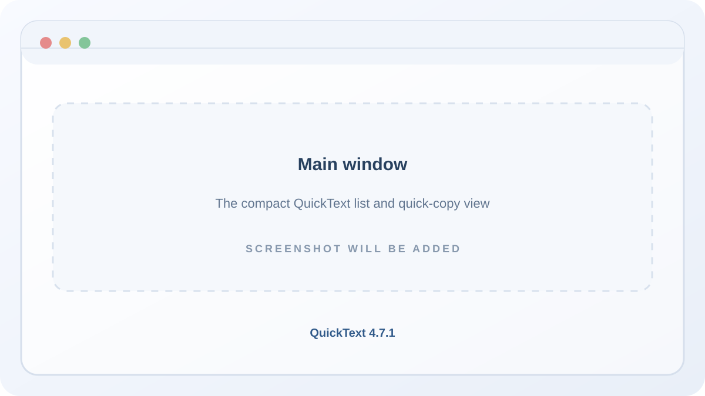
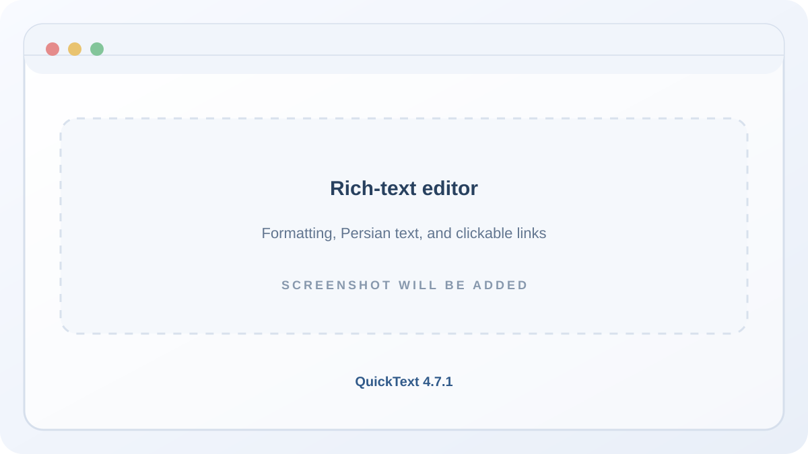
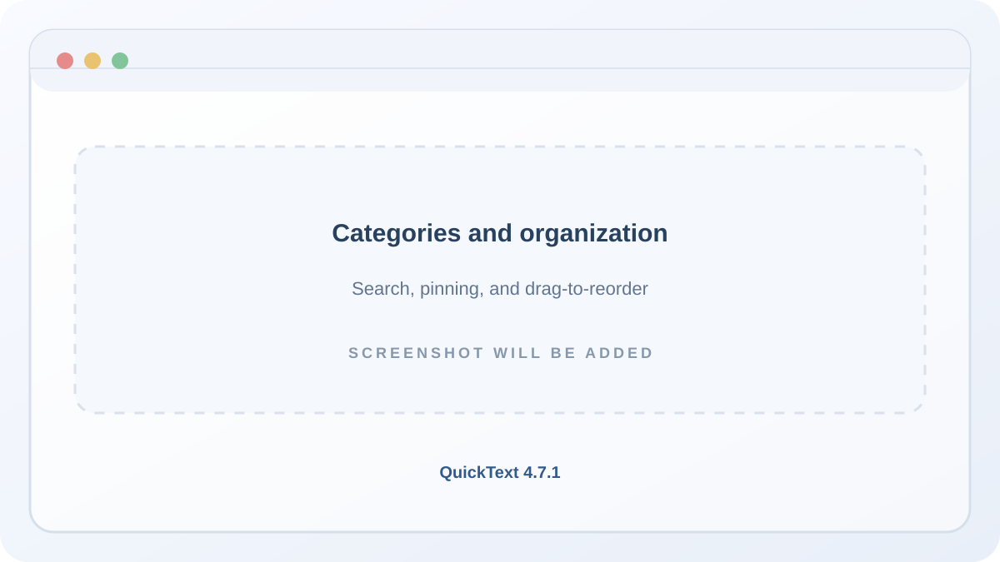

# QuickText
### برنامه‌ای سبک و جمع‌وجور برای مدیریت متن‌ها و پرامپت‌های پرتکرار در ویندوز

QuickText کمک می‌کند متن‌ها، پرامپت‌ها، پاسخ‌های آماده، قالب‌ها و دستورالعمل‌هایی را که مرتب استفاده می‌کنید، در یک پنجره کوچک و مرتب نگه دارید. هر مورد را یک بار ذخیره کنید، سریع پیدایش کنید و با یک کلیک متن کاملش را کپی کنید.

**برنامه آفلاین است:** برای استفاده روزمره به حساب کاربری، اینترنت، فضای ابری یا اشتراک نیاز ندارد.

نام فعلی برنامه **QuickText** است؛ نسخه‌های قبلی آن با نام **Quick Prompt** منتشر شده بودند. آدرس مخزن GitHub برای حفظ لینک‌های قبلی تغییر نکرده است.

## قابلیت‌ها

- **کپی سریع:** با یک کلیک روی هر کارت، متن کامل آن در کلیپ‌بورد کپی می‌شود.
- **دسته‌بندی:** متن‌ها را در گروه‌های دلخواه قرار دهید و از فیلتر دسته‌بندی استفاده کنید.
- **جستجوی سریع:** جستجو در عنوان، متن و دسته‌بندی؛ همچنین پیدا کردن مورد با شماره یا قالب <code>#شماره</code>.
- **سنجاق و مرتب‌سازی:** موارد مهم را Pin کنید و ترتیب کارت‌ها را با کشیدن و رها کردن تغییر دهید.
- **ویرایشگر متن:** ضخیم، مورب، زیرخط، اندازه فونت، رنگ متن، رنگ پس‌زمینه، تراز چپ/وسط/راست و Justify.
- **لینک قابل کلیک:** روی بخشی از متن لینک قرار دهید؛ هنگام کپی، قالب و آدرس لینک تا حد پشتیبانی برنامه مقصد حفظ می‌شود.
- **پشتیبانی از فارسی و یونیکد:** مناسب متن فارسی راست‌به‌چپ، ترکی استانبولی و سایر زبان‌ها.
- **پنجره شناور:** اندازه پنجره را تغییر دهید، آن را همیشه روی پنجره‌های دیگر نگه دارید و اندازه دلخواه را ذخیره کنید.
- **System Tray و اجرای خودکار:** دسترسی از کنار ساعت ویندوز، اجرای اختیاری هنگام روشن شدن ویندوز و شروع به‌صورت Minimized.
- **حریم خصوصی:** متن‌های ذخیره‌شده روی کامپیوتر خودتان می‌مانند و به سرور ارسال نمی‌شوند.

## تصاویر برنامه

محل سه تصویر زیر آماده است. در به‌روزرسانی بعدی، تصاویر واقعی برنامه جایگزین این نمونه‌ها می‌شوند.

  
  
  

## دانلود آخرین نسخه ویندوز

در بخش انتشار آخرین نسخه، فقط دو فایل اصلی برای دانلود قرار می‌گیرد:

| نسخه | توضیح | لینک |
|---|---|---|
| **Setup.exe** | نصب معمولی برای کاربر فعلی ویندوز؛ همراه با میانبر دسکتاپ، منوی Start و حذف نصب | [دانلود QuickText Setup](https://github.com/amirhoseinteras/quick-prompt/releases/latest/download/QuickText-Setup.exe) |
| **Portable.zip** | بدون نصب؛ فایل ZIP را استخراج کنید و <code>QuickText.exe</code> را اجرا کنید | [دانلود QuickText Portable](https://github.com/amirhoseinteras/quick-prompt/releases/latest/download/QuickText-Portable.zip) |

- اگر نصب معمولی و میانبر ویندوز می‌خواهید، نسخه **Setup** را بگیرید.
- اگر نمی‌خواهید نصب انجام دهید، نسخه **Portable** مناسب است.
- هر دو نسخه از همان محل ذخیره اطلاعات کاربر استفاده می‌کنند.

## اطلاعات ذخیره‌شده کجا هستند؟

متن‌های شما به‌صورت محلی در این مسیر نگهداری می‌شوند:

<code>%APPDATA%\QuickPrompt\prompts.json</code>

نام پوشه عمداً از نسخه قبلی حفظ شده تا اطلاعات کاربران Quick Prompt با نصب QuickText از بین نرود. نصب نسخه جدید، متن‌های ذخیره‌شده را حذف نمی‌کند.

## پیش‌نیازها

- Windows 10 یا Windows 11
- .NET Framework 4.x
- بدون نیاز به حساب کاربری یا اتصال اینترنت برای استفاده معمول

## ساخت از سورس

در PowerShell و داخل پوشه مخزن:

~~~powershell
powershell -ExecutionPolicy Bypass -File .\build.ps1 -RunTests
~~~

این دستور برنامه را کامپایل می‌کند، آزمون‌های داخلی را اجرا می‌کند و بسته‌های Setup و Portable را می‌سازد.

## نکته امنیتی

فایل اجرایی فعلی امضای دیجیتال ندارد و ممکن است Windows SmartScreen هشدار نمایش دهد. پیش از اجرا، سورس و مقدار SHA-256 درج‌شده در توضیحات انتشار را بررسی کنید. برای عبور از هشدار، محافظت ویندوز را خاموش نکنید.

## مجوز و پشتیبانی

QuickText با مجوز [MIT](LICENSE) منتشر شده است.

برای گزارش مشکل یا پیشنهاد قابلیت جدید، از [صفحه Issues](https://github.com/amirhoseinteras/quick-prompt/issues) استفاده کنید.

