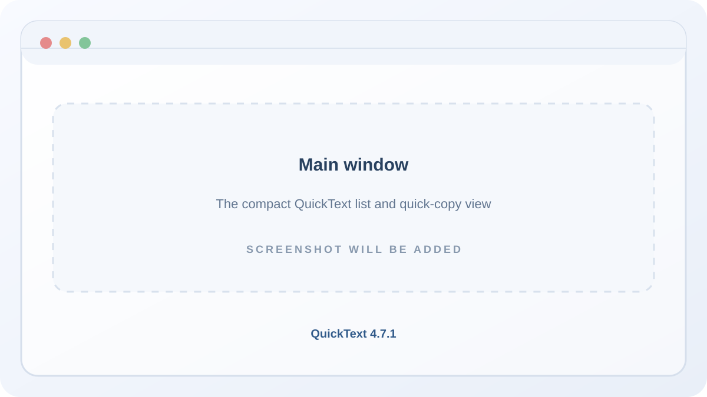
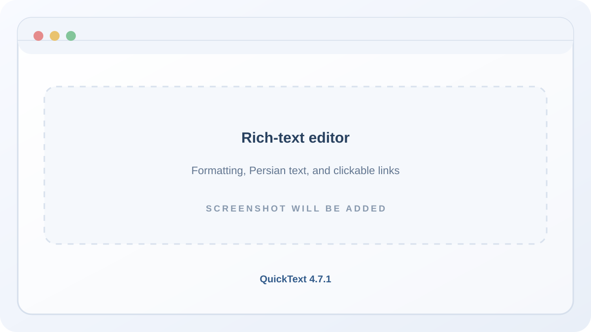
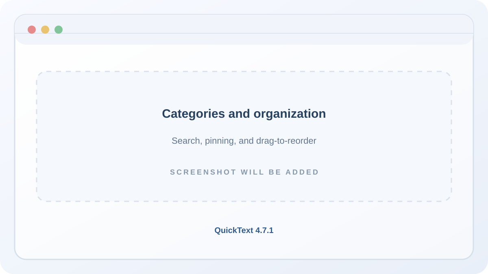

  

<h1 align="center">QuickText</h1>

<strong>A lightweight, offline-first text and prompt manager for Windows.</strong>

  Keep your reusable text one click away — tidy, searchable, and ready to paste.

  <a href="https://github.com/amirhoseinteras/quick-prompt/releases/latest/download/QuickText-Setup.exe"><strong>Download Setup</strong></a>
  ·
  <a href="https://github.com/amirhoseinteras/quick-prompt/releases/latest/download/QuickText-Portable.zip"><strong>Download Portable</strong></a>
  ·
  <a href="https://github.com/amirhoseinteras/quick-prompt/releases/latest">All releases</a>

  
  
  
  

---

## A small tool for text you use every day

QuickText helps you keep frequently used prompts, replies, templates, instructions, and snippets in one compact Windows app. Create an item once, find it when you need it, and copy the full text with a single click.

It is designed to stay simple: no account, no cloud service, no subscription, and no internet connection required for everyday use.

**QuickText is the current name of the app previously published as Quick Prompt.** The existing repository address is retained so older links continue to work.

## Features

- **One-click copy:** click a saved item to copy its complete text to the clipboard.
- **Stay organized:** group items with categories, pin important entries, and drag cards to change their order.
- **Fast search:** search titles, content, and categories; jump to an item by its number or by typing <code>#number</code>.
- **Rich-text editor:** use bold, italic, underline, font sizing, text color, highlighting, and left, center, right, or justified alignment.
- **Clickable links:** add links to selected text. When copied, the app preserves the link and rich-text formats where the destination app supports them.
- **Persian and Unicode ready:** work with Persian text, right-to-left content, Turkish characters, and other Unicode text.
- **Compact floating window:** resize the app, keep it always on top, and let it remember your window size.
- **Tray and startup options:** access QuickText from the Windows notification area, optionally start it with Windows, or start it minimized.
- **Private by design:** prompt content is stored locally in your Windows user profile. QuickText does not upload your saved text.

## Screenshots

The image areas below are ready for the real application screenshots. They will be replaced with actual captures in a later update.

  
  
  

## Download for Windows

Choose one of the two packages below. The latest release contains only these two user-facing downloads.

| Package | Best for | Download |
| --- | --- | --- |
| **Setup (.exe)** | Normal installation for the current Windows user. Creates Start Menu and Desktop shortcuts and an uninstall entry. | [Download QuickText Setup](https://github.com/amirhoseinteras/quick-prompt/releases/latest/download/QuickText-Setup.exe) |
| **Portable (.zip)** | Running without an installer. Extract the ZIP and launch <code>QuickText.exe</code>. | [Download QuickText Portable](https://github.com/amirhoseinteras/quick-prompt/releases/latest/download/QuickText-Portable.zip) |

### Setup or Portable?

- Choose **Setup** if you want QuickText installed like a regular Windows application.
- Choose **Portable** if you prefer to extract the files and run the app directly. The ZIP contains only the executable and the support files it needs.

Both packages use the same local prompt collection. The Portable version does not put your saved prompts inside the ZIP folder.

## Your data stays yours

Your saved items are stored locally at:

<code>%APPDATA%\QuickPrompt\prompts.json</code>

The folder name is intentionally kept for compatibility with the earlier Quick Prompt release. Installing QuickText 4.7.1 over an existing installation keeps the same saved prompts; the installer does not remove your personal data.

QuickText does not require an account, cloud sync, analytics, or an online service.

## Requirements

- Windows 10 or Windows 11
- .NET Framework 4.x
- No account or internet connection required for normal use

## Build from source

Open PowerShell in the repository folder and run:

~~~powershell
powershell -ExecutionPolicy Bypass -File .\build.ps1 -RunTests
~~~

The build script compiles the Windows application, runs the built-in checks, and creates the Setup and Portable packages. The current source includes checks for pinning, item numbering, rich links, Unicode text, and local data operations.

For a compile-and-test run without packaging:

~~~powershell
powershell -ExecutionPolicy Bypass -File .\build.ps1 -RunTests -NoPackage
~~~

## Security note

The published Windows executable is not code-signed. Windows SmartScreen or an organization’s application-control policy may show a warning. Review the source and verify the SHA-256 values listed in the release notes before running a downloaded file. Do not disable Windows security protections to bypass a warning.

## License

QuickText is released under the [MIT License](LICENSE).

## Feedback and contributions

Found a bug or have an idea? [Open an issue](https://github.com/amirhoseinteras/quick-prompt/issues) with your Windows version and clear reproduction steps. Contributions and documentation improvements are welcome.

---

Made to keep useful text close, without getting in your way.

